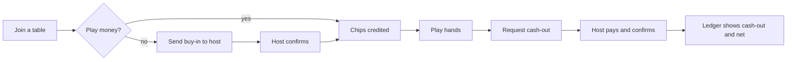
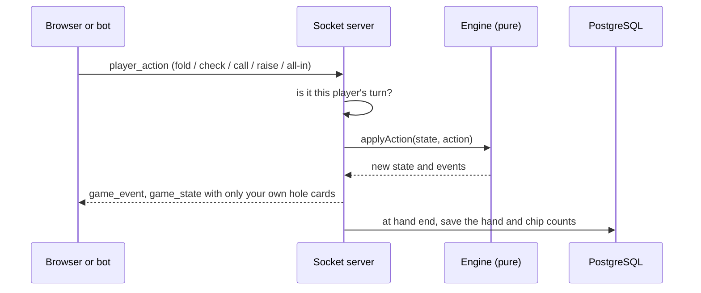

# pocăr

Private Texas Hold'em for a group of friends: live tables in the browser, built-in and bring-your-own bots, and a ledger that tracks real-money buy-ins and cash-outs without ever holding the money.

## What it does

| Part | What happens |
|---|---|
| **Tables** | Up to 9 players per table, in real time over Socket.io. Blinds, dealer rotation, side pots, a 30-second turn timer that checks or folds for you, sitting out and back in, and late joiners dealt in on the next hand. |
| **Buy-ins** | Players send their buy-in straight to the host (Revolut or similar) and tap *I sent the money*. Their chips appear once the host confirms the money arrived. |
| **Cash-outs** | A player asks to cash out, the host pays them outside the app and confirms, and the session ledger records the amount and the net result. |
| **Play money** | Play-money tables skip transfers: chips are credited when you sit down. |
| **Bots** | Built-in bots (Call Station and a tight-aggressive TAG bot) fill seats on mixed or bots-only tables. You can also register your own bot and drive it over the socket API from any program. |
| **Profiles** | Display name, avatar, and statistics split by real or play money and by human, mixed or bot tables. Every hand is saved. |
| **Invite only** | Registration needs the group's invite code. |



Every action goes through the server, which owns the game state:



## Design choices

- **The engine is pure.** `src/lib/poker/engine.ts` takes a game state and an action and returns a new state plus events, with no I/O or timers. That keeps it testable: one test plays 300 random hands and checks that chips are never created or lost.
- **The server is the authority.** Clients send intentions and the server decides. It checks that it is the player's turn, and the engine rejects anything illegal, such as a raise below the minimum or a check while facing a bet. Each player receives a state with only their own hole cards. Opponents' cards stay hidden until showdown.
- **Identity comes from the session.** Browsers are identified by the NextAuth session cookie sent with the socket handshake, and bots by an API key. Nothing a client says about itself is trusted.
- **Side pots are layers.** At showdown the pot is split into layers by how much each player put in. Each layer goes to the best hand among the players who paid into it, an uncalled bet goes back to whoever made it, and an odd chip goes to the first winner left of the dealer.
- **A ledger, not a wallet.** The app never touches money. It records who sent, who confirmed and who was paid, so the group can settle up. Confirmations are conditional updates, so a double click cannot credit a buy-in twice.
- **Integer cents.** All amounts are stored in cents, so there is no floating-point drift.
- **A fair shuffle.** Decks are shuffled with Fisher-Yates over `crypto.getRandomValues`, not `Math.random`.
- **Bots play by the same rules.** Built-in and external bots see exactly what a human in their seat sees, and their decisions are clamped to legal actions.

## Getting started

Requires Node.js 20.19 or newer and PostgreSQL.

```bash
npm install
cp .env.example .env.local    # then fill in the values
npm run db:push               # create the tables
npm run dev                   # http://localhost:3000
```

No PostgreSQL installed? `npx prisma dev` starts a local one and prints a connection string you can use as `DATABASE_URL`.

| Variable | Purpose |
|---|---|
| `DATABASE_URL` | PostgreSQL connection string |
| `NEXTAUTH_SECRET` | Signs session cookies. Generate one with `openssl rand -base64 32` |
| `NEXTAUTH_URL` | Public URL of the app, for example `http://localhost:3000` |
| `INVITE_CODE` | The code friends need in order to register |

| Command | What it does |
|---|---|
| `npm run dev` | Start the custom server (Next.js and Socket.io) in development. Plain `next dev` has no socket server, so tables will not work |
| `npm run build` | Production build |
| `npm start` | Serve the production build |
| `npm test` | Engine, hand evaluator and deck tests |
| `npm run lint` | Run ESLint |
| `npm run db:push` | Sync the Prisma schema to the database |
| `npm run db:studio` | Browse the database in Prisma Studio |

## Writing a bot

1. Open **Profile**, register a bot under **My bots** and copy its API key.
2. Ask the host to add your bot to a mixed or bots-only table.
3. Run the example, which calls everything, and change its strategy:

```bash
node bots/example-bot.mjs http://localhost:3000 <API_KEY> <SESSION_ID>
```

A bot connects with `auth: { apiKey }`, emits `join_session`, and receives the same `game_state` and `game_event` messages as the browser, with its own cards in `yourHoleCards`. When a `next_turn` event names the bot, it answers with `player_action`: `fold`, `check`, `call`, `all_in`, or `raise` with `amount` as the total to raise to. Illegal actions are ignored, and the turn timer checks or folds for a bot that does not answer.

Built-in bots live in `src/lib/bots/`. Each one is a `decide(view)` function, and listing it in `registry.ts` makes it appear in the *Add bot* menu.

## Tech stack

Next.js 16 (App Router), React 19, TypeScript, Tailwind CSS 4, Socket.io on a custom Node server, PostgreSQL with Prisma 7, NextAuth v5 (credentials, JWT sessions), `node:test` with tsx.

## Project layout

```
server.ts                  HTTP server that runs Next.js and Socket.io together
env-load.ts                loads .env files the way Next.js does
prisma/schema.prisma       users, sessions, seats, hands, actions
src/
  lib/poker/               pure game engine, hand evaluator, deck, tests
  lib/socket/handlers.ts   socket auth, table events, turn timers, saving hands
  lib/bots/                built-in bots and their registry
  app/lobby/               create and join tables
  app/session/[id]/        buy-ins, cash-outs, session ledger
  app/table/[id]/          the live table
  app/profile/             profile, stats, your bots
  app/api/                 auth, sessions, bots and profile routes
  components/poker/        table, seats, cards, action bar
bots/example-bot.mjs       starting point for an external bot
```

## Limitations

- Live game state is kept in memory. A server restart cancels the hand in progress, and the table resumes from the chip counts saved after the last finished hand.
- Tables run in a single server process, so the app cannot be scaled across several instances as is.

## Roadmap

- Save hands in progress so a restart does not cancel them
- Hand history replay on the profile page
- Rate limiting on login and registration
- Tests for the socket layer

## Author

Designed and built by **Eduard Dehelean**.
